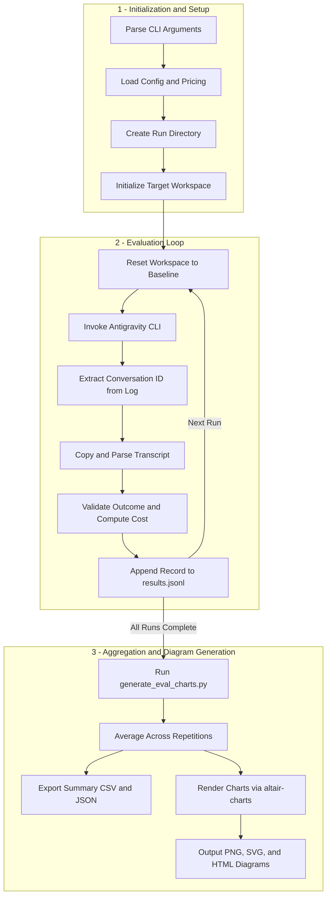

# Antigravity Efforts Benchmark

A simple evaluation harness for testing and comparing different effort level configurations with the Antigravity CLI (`agy`).

It executes repeatable coding scenarios against a target repository, validates the outcome of each run, and records performance metrics including execution duration, pass/fail status, token usage, tool call counts, and estimated cost.

## Prerequisites

- [Node.js](https://nodejs.org/)
- [zx](https://github.com/google/zx) (`npx zx` or installed globally)
- Antigravity CLI (`agy`) installed and available in your `PATH`
- `git`

## Usage

Run the benchmark harness with default settings:

```bash
npx zx benchmark.mjs
```

By default, [benchmark.mjs](./benchmark.mjs) loads scenarios from [zx.config.mjs](./zx.config.mjs), clones the target repository (`google/zx`) if not already present, and runs each scenario 3 times across all 6 default model and effort configurations:

- `gemini-3.8-flash-low`
- `gemini-3.8-flash-medium`
- `gemini-3.8-flash-high`
- `gemini-4-argon-low`
- `gemini-4-argon-medium`
- `gemini-4-argon-high`

### CLI Options

- `--config`, `-c`: Path to the benchmark configuration file (default: `zx.config.mjs`)
- `--models`, `--model`, `-m`: Comma-separated list of model and effort configurations to evaluate (default: `gemini-3.8-flash-low,gemini-3.8-flash-medium,gemini-3.8-flash-high,gemini-4-argon-low,gemini-4-argon-medium,gemini-4-argon-high`)
- `--repetitions`, `-r`: Number of repetitions per scenario and model (default: `3`)
- `--scenarios`, `--scenario`, `-s`: Comma-separated list of scenario IDs or substrings to run (default: all scenarios)
- `--help`, `-h`: Show help and list available scenarios from the active configuration file

### Examples

Evaluate specific effort levels across models with 5 repetitions:

```bash
npx zx benchmark.mjs --models gemini-3.8-flash-low,gemini-4-argon-high --repetitions 5
```

Run a single scenario using a custom configuration file:

```bash
npx zx benchmark.mjs --config zx.config.mjs --scenarios 1_read_env_audit --repetitions 1
```

## Output and Artifacts

Each benchmark run creates a timestamped directory under `benchmark-runs/YYYYMMDDHHMM/` containing:

- `results.jsonl`: Structured JSON Lines log with one entry per run (model, effort level, scenario ID, pass/fail status, duration, token counts, tool calls, and optional cost if `api_list_prices.json` is present).
- `agy_<scenario>_<model>_run<N>.log`: Debug log from the `agy` invocation.
- `transcript_<scenario>_<model>_run<N>.jsonl`: Copy of the full conversation transcript for the run.

## Architecture & Evaluation Workflow

The diagram below illustrates how [benchmark.mjs](./benchmark.mjs) executes benchmark evaluations across scenarios, models, and effort tiers, and how the results are aggregated into charts via [generate_eval_charts.py](./.agents/skills/eval-charts/scripts/generate_eval_charts.py) and the [altair-charts](./.agents/skills/altair-charts/SKILL.md) toolkit:



### Generating Evaluation Diagrams

After a benchmark run completes, generate summary tables and evaluation charts from `results.jsonl` using [generate_eval_charts.py](./.agents/skills/eval-charts/scripts/generate_eval_charts.py):

```bash
.venv/bin/python .agents/skills/eval-charts/scripts/generate_eval_charts.py \
  --input benchmark-runs/<YYYYMMDDHHMM>/results.jsonl \
  --output-dir benchmark-runs/<YYYYMMDDHHMM>/charts \
  --metrics all
```

## Custom Configurations

To benchmark against a different repository or set of tasks, create a configuration `.mjs` file and pass it via `--config`. See [zx.config.mjs](./zx.config.mjs) for an example defining `init`, `reset`, and `scenarios` (each with an `id`, `name`, `prompt`, and async `validator` function).

## License

Licensed under the Apache License, Version 2.0. See [LICENSE](./LICENSE) for details.

## Disclaimer

This is not an official Google product.
